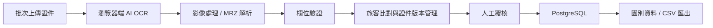

# Passport Scanner V2
## 旅行社旅客證件 OCR 辨識與資料管理系統

> 從旅行社實際的證件建檔流程出發，把「掃描文字」延伸成一套可審核、可驗證、可管理旅客資料的工作流程。

**目前狀態：持續開發中｜Public Repository｜不提交真實證件影像與旅客個資**

---

## 這個專案解決什麼問題？

旅行社收到旅客證件後，傳統流程常需要人工查看照片，再逐欄輸入姓名、證件號碼、出生日期、有效期限等資料。

V2 不把目標放在「做一個 OCR Demo」，而是處理 OCR 之後真正會遇到的問題：

- OCR 結果怎麼轉成結構化欄位？
- 怎麼檢查 MRZ、日期、證件號碼等資料是否合理？
- 同一位旅客不同時間上傳多張證件時，怎麼比對與合併？
- OCR 不可靠時，怎麼保留人工覆核？
- 真實證件影像與開發資料怎麼避免直接進入 Git？

---

## 系統流程



目前主要證件流程包含：

- 護照
- 台胞證
- 台灣身分證

OCR 主要在瀏覽器端執行，後端負責 typed payload 驗證、旅客資料邏輯與 PostgreSQL persistence。

---

## V1 → V2 的差異

| V1 | V2 |
|---|---|
| 偏向單次 OCR / 資料擷取 | 完整證件資料處理流程 |
| 雲端 AI / API 為主 | 瀏覽器端 PaddleOCR 為主 |
| 辨識後直接取得結果 | OCR 後仍有欄位驗證與人工覆核 |
| 單筆資料處理 | 批次掃描、旅客比對、證件版本管理 |
| 著重「辨識出文字」 | 著重「建立可實際使用的旅客資料」 |

---

## 核心功能

### 01｜Browser-side AI OCR

- PaddleOCR.js / PP-OCRv5
- 瀏覽器端推論
- 影像方向處理與裁切
- 護照 MRZ parsing
- TD3 check digit 驗證
- 中文姓名辨識與候選處理

### 02｜資料驗證

辨識結果不直接視為正確資料。

前後端會依欄位進行格式與業務規則驗證，例如：

- 護照號碼
- 出生日期
- 有效期限
- 國籍 / 簽發國
- 台灣身分證 checksum
- MRZ composite check digit

### 03｜Traveler Matching

系統不是把每張證件都當成不同的人。

目前資料模型將：

- Traveler 主檔
- Document Version
- Scan / Review 工作資料

分開處理，以支援同一旅客重新掃描、換發新證件，以及多證件整合。

### 04｜Human-in-the-loop Review

OCR 只是輔助。

```text
OCR
 ↓
欄位解析
 ↓
自動驗證
 ↓
人工對照原圖
 ↓
確認後才進正式旅客資料
```

審核介面支援影像縮放、拖移、旋轉與欄位編輯，避免把模型輸出直接當成最終答案。

### 05｜團別與 CSV 匯出

已審核旅客可進入團別資料流程，並依證件類型選擇需要欄位後匯出 CSV。

---

## 技術架構

| Layer | Technology |
|---|---|
| Frontend | Vue 3 · TypeScript · Vite |
| OCR | PaddleOCR.js · PP-OCRv5 · Tesseract.js（實驗比較） |
| Backend | ASP.NET Core Web API · .NET 10 |
| Database | PostgreSQL 16 |
| Container | Docker · Docker Compose · Nginx |
| Validation | MRZ Check Digit · Field Validation · Synthetic Regression Tests |
| Version Control | Git · GitHub |

```text
Browser
 ├─ Vue UI
 ├─ Image Processing
 └─ PaddleOCR
        │
        ▼
ASP.NET Core Web API
 ├─ Validation
 ├─ Traveler Matching
 └─ Document Version Logic
        │
        ▼
PostgreSQL
```

---

## OCR 驗證方式

這個專案有刻意保留「實驗結果 ≠ 真實泛化能力」的界線。

目前曾使用固定 Validation set 做迭代比較。已確認的歷史基準包含：

- 護照：固定樣本中文姓名 / 全欄曾達 **14 / 19**
- 台胞證：固定樣本必要欄位曾達 **13 / 13**

這些數字只代表特定 legacy Validation set 的結果，**不能解讀成新照片的 74% / 100% 泛化準確率**。

後續模型、ROI、selector、Server Recognition 等實驗只有在真正量測後才會記錄為改善；沒有改善的方案也會保留在開發紀錄中，避免重複走同一條失敗路線。

---

## Privacy by Design

這個 repository 已公開，但**真實資料不公開**。

不應提交：

- 真實護照 / 身分證 / 台胞證照片
- 真實旅客姓名、身分證字號、護照號碼、MRZ
- PostgreSQL database dump
- OCR training / validation private dataset
- `.env`、API key、private key、service account credentials

Repository 中保留的是：

- Source code
- Synthetic test fixtures
- Schema / architecture
- 匿名化 aggregate metrics
- Placeholder environment configuration

詳細原則請看 [SECURITY.md](./SECURITY.md)。

---

## 直接看程式碼

如果想直接確認實作內容，可以從這些地方開始：

- [Frontend / Vue 3 + TypeScript](./frontend/src)
- [OCR 與影像處理](./frontend/src/services)
- [ASP.NET Core Backend](./backend/PassportScanner.Api)
- [Domain / Traveler & Document Logic](./backend/PassportScanner.Api/Domain)
- [Database / Persistence](./backend/PassportScanner.Api/Persistence)
- [OCR Regression / Validation Scripts](./frontend/scripts)
- [Docker Compose](./docker-compose.yml)

這些連結直接指向實際 source code，而不是只有功能說明。

---

## 專案文件

如果想確認這不是只有 README，可以直接往下看實際的系統設計與開發紀錄：

- [System Architecture](./docs/SYSTEM_ARCHITECTURE.md)
- [Data Model](./docs/DATA_MODEL.md)
- [OCR Requirements](./docs/OCR_REQUIREMENTS.md)
- [OCR PoC / Engine Evaluation](./docs/OCR_POC.md)
- [Development Setup](./docs/DEVELOPMENT.md)
- [Project Decisions](./docs/DECISIONS.md)
- [Current Handoff / Development Status](./docs/HANDOFF.md)
- [Security & Privacy](./SECURITY.md)

---

## 可重現驗證

除了閱讀 README，也可以直接執行目前 repository 內的程式與回歸檢查：

### Frontend / OCR

```bash
cd frontend
npm ci
npm run verify:ocr
```

`verify:ocr` 會執行 OCR regression scripts、TypeScript type check 與 Vite build。測試內容以 synthetic / static regression 為主，不需要把真實證件資料放進 Git。

### Backend

```bash
dotnet build backend/PassportScanner.Api/PassportScanner.Api.csproj
```

### Full stack

```bash
docker compose config
docker compose up -d --build
```

> 固定 Validation set 的真實證件影像不屬於公開 repository，因此公開程式碼可以重現 build / regression 流程，但不能從 GitHub 直接重跑私人 Validation dataset。

---
## 本機啟動

建立本機環境設定：

```bash
cp .env.example .env
```

啟動完整服務：

```bash
docker compose up -d --build
```

主要開發服務：

```text
Frontend   Vue 3 / Vite
Backend    ASP.NET Core Web API
Database   PostgreSQL
```

> `.env.example` 只有 placeholder。請勿把正式密碼或任何 API key commit 到 Git。

---

## 專案定位

這不是完整 ERP，也不是旅客端自助平台。

目前 V2 專注在：

**證件輸入 → AI OCR → 資料驗證 → 旅客比對 → 人工覆核 → 正式資料**

未來如果繼續擴充，才會再考慮與 ERP / CRM / 出團管理等模組整合。

---

## Why this project matters to me

這個專案不是從「想做 OCR」開始，而是從實際重複輸入證件資料的工作流程開始。

我希望把技術放進真正的作業流程裡，所以比起單純提高模型辨識率，我更在意：

**資料是否可靠、錯誤是否能被發現、人工是否能介入，以及系統最後能不能真正被使用。**
